# scExplorer - User Guide

scExplorer is an upload based browser app for exploring any Seurat object, no
coding needed. This guide has two parts:

- Part 1 - Documentation: a tour of every tab and control.
- Part 2 - Use cases
---

# Part 1 - Documentation

## Loading data

On the start page a single card sits in the middle of the screen:

- Upload your own data - drag and drop or Browse to, a Seurat object saved as a
  `.rds` file.
- Use example data - loads a small bundled demo object.


<p align="center">
  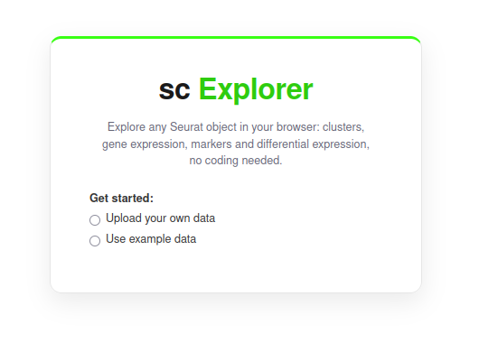
  <br><em>Figure 1. The start page: choose to upload a Seurat .rds or use the example data.</em>
</p>

### What the object needs

Any Seurat object works. Two things are required; everything else is optional.

Required:

- A dimensionality reduction to plot on - a 2D embedding such as umap, tsne or pca
  (or a foundation model embedding saved as a reduction). A fresh object built
  straight from a count matrix has none yet, so run `RunPCA()` then `RunUMAP()` first.
- Metadata columns to explore - cell type, condition, sample, clusters, numeric
  scores. The more it has, the richer the colouring and grouping options.

Optional:

- Extra assays and layers - detected automatically; the app uses RNA / Normalized
  (see the next section).
- Precomputed marker or contrast tables - not needed. Markers and differential
  expression are always computed live in the app.

If your object has no reduction yet, run the standard Seurat pipeline once in R and
save the result, then upload that `.rds`:

```r
library(Seurat)

seu <- NormalizeData(seu)
seu <- FindVariableFeatures(seu)
seu <- ScaleData(seu)
seu <- RunPCA(seu)
seu <- FindNeighbors(seu, dims = 1:30)
seu <- FindClusters(seu, resolution = 0.5)   # adds a clustering column
seu <- RunUMAP(seu, dims = 1:30)             # adds the umap embedding the app plots on

saveRDS(seu, "my_object_for_scexplorer.rds")
```

This gives the app everything it needs: a umap reduction to plot on, a clustering
column to colour by, and the normalized values it reads for expression and markers.

## Data info panel

Under the title is a collapsible "Data info" bar; click it to open. Inside:

- The loaded file name.
- Three summary cards: Cells, Genes, and Samples (distinct samples or batches
  detected from a sample/batch column; shows `-` if none).
- An Assays/layers strip listing every assay and the layers it contains, for
  example `RNA: counts data   SCT: counts data scale.data`.

<p align="center">
  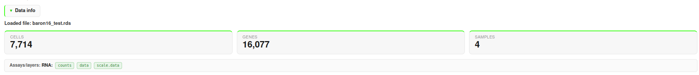
  <br><em>Figure 2. The Data info panel: file name, summary cards and the assays/layers strip.</em>
</p>

## What the analysis uses

The app uses one consistent setup everywhere:

- Assay: RNA. If the RNA assay has no normalized data layer, the app falls back
  to SCT, then to the object's default assay.
- Values: Normalized (log) expression.
- Statistical test (markers and per cell differential expression): Wilcoxon.

Pseudobulk differential expression instead uses raw RNA counts.
The Assays/layers strip in Data info shows whether RNA is normalized.

## Downloading plots and tables

- Plots: hover over any plot and its toolbar appears top right. The camera icon
  saves the plot as a PNG; the toolbar also has zoom, pan, box/lasso select,
  autoscale and reset.
- Download all as one PNG: when a tab shows several panels (Per gene maps, or the
  Split by group view), a "Download all as one PNG" button composites every panel
  into a single image.
- Tables: every results table has a "Download Excel" button that saves all rows as
  an `.xlsx`, plus a search box at its top right that filters all columns as you
  type.

## 1. Clusters / Metadata

The map of your cells: each point is one cell, positioned by a dimensionality
reduction and coloured by a metadata column you choose. Controls sit in a bar at
the top and the plot renders below.

| Control | What it does |
|---|---|
| Reduction | Which embedding to plot on (umap, pca or any reduction in the object). Appears when the object has more than one. Points are laid out by this. Colouring is separate. |
| Color UMAP by | Colour cells by any metadata column - cell type, sample, condition, phase, clustering or a numeric score. |
| Show categories (categorical columns) | Tick or untick each category to show or hide it. Hidden ones turn grey. |
| Min / Max (numeric columns) | Type a value range to keep. Cells outside it turn grey. |
| Split by group (checkbox) | Tick to break the map into small multiples, one panel per group. It reveals Split by (which column) and Groups to show (which groups get a panel). |

Categorical vs. numeric is auto detected. Categorical columns (clusters, cell types)
get distinct colours plus the Show categories checkboxes. Numeric columns (scores,
QC metrics) get a viridis gradient with a colorbar, exact hover value and the
Min/Max filter. Clustering columns are always categorical, however many clusters
they have.

<p align="center">
  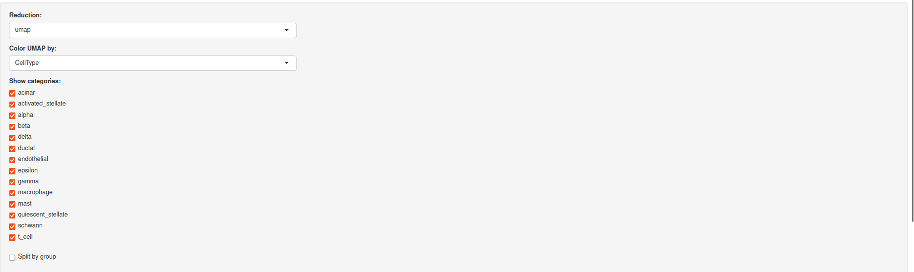
  <br><em>Figure 3a. The Clusters / Metadata controls.</em>
</p>

<p align="center">
  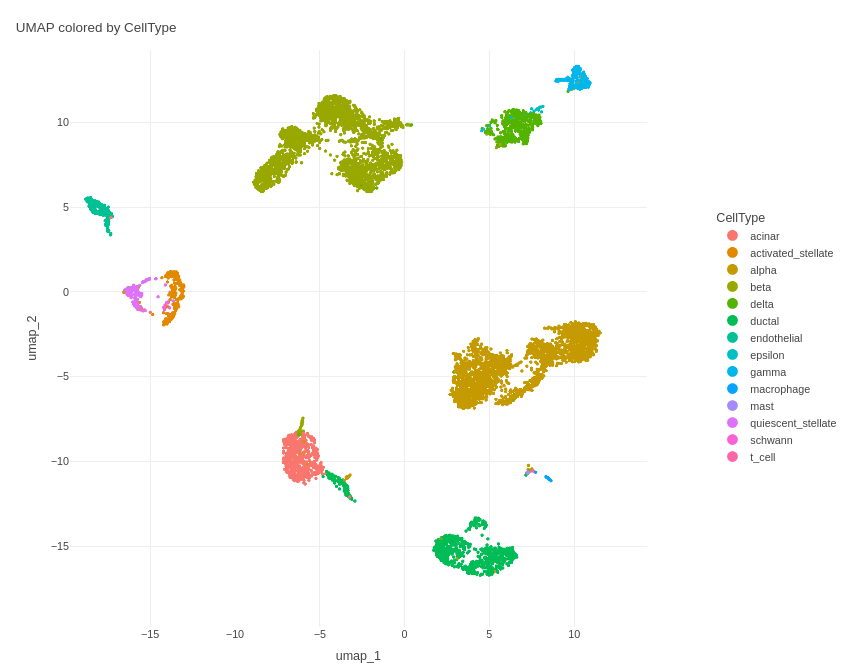
  <br><em>Figure 3b. The resulting UMAP, coloured by a categorical column. </em>
</p>

Split by group: pick the Split by column, then choose the exact groups in Groups to
show. 

<p align="center">
  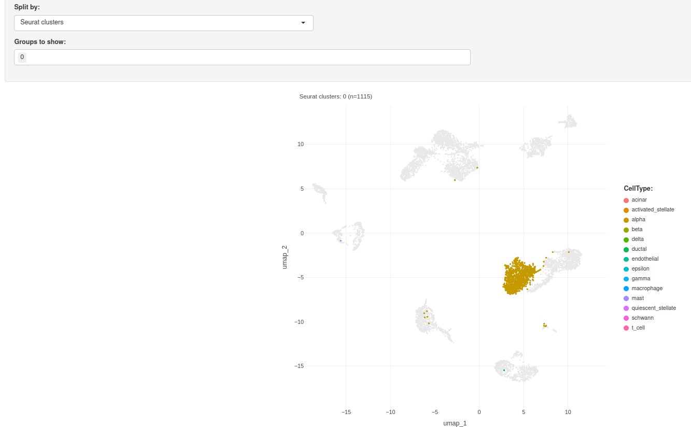
  <br><em>Figure 4. Split by group: one panel per group over a shared grey backdrop.</em>
</p>

Category order: everywhere categories are listed they are sorted naturally,
numerically when the labels are numbers (0, 1, 2, ..., 10, 11), otherwise
alphabetically.

## 2. Gene Expression

Uses the RNA assay and Normalized (log) values. Two sub tabs (the smaller green
buttons).

### Per gene maps

One UMAP per gene, coloured by that gene's expression on a blue to white to red
scale (low = blue, high = red).

| Control | What it does |
|---|---|
| Sort genes by | Orders the gene menu: Alphabetical or Highest / Lowest average expression |
| Gene(s) | Type one or more gene symbol. Each gets its own UMAP |
| Plots per row | Grid width (1 to 4), layout only |
| Color scale: Same scale for all genes | All plots share one colorbar - compare magnitude across genes |
| Color scale: Scale adjusted per gene | Each plot uses its own range - see the pattern even for weakly expressed genes |


<p align="center">
  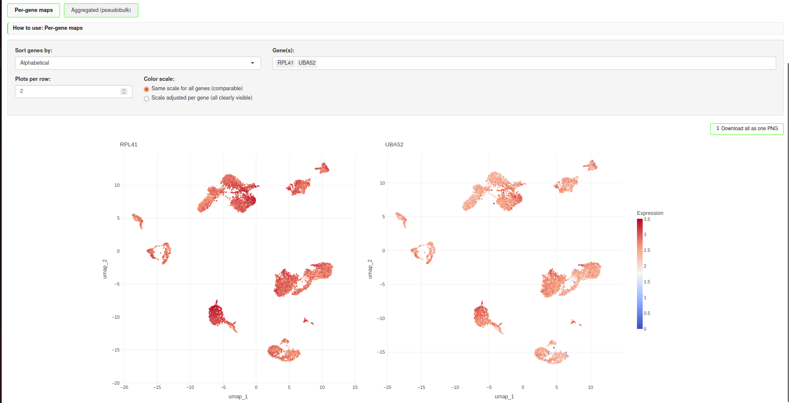
  <br><em>Figure 5. Per gene maps: one expression UMAP per selected gene.</em>
</p>

### Aggregated (pseudobulk)

A compact overview: for each selected gene, one summary value per group, as a
heatmap and a table.

| Control | What it does |
|---|---|
| Aggregate by | Metadata column defining the groups (heatmap columns) |
| Gene(s) | Genes become the heatmap rows |
| Summary per group | Mean, Sum, or Median per group |

<p align="center">
  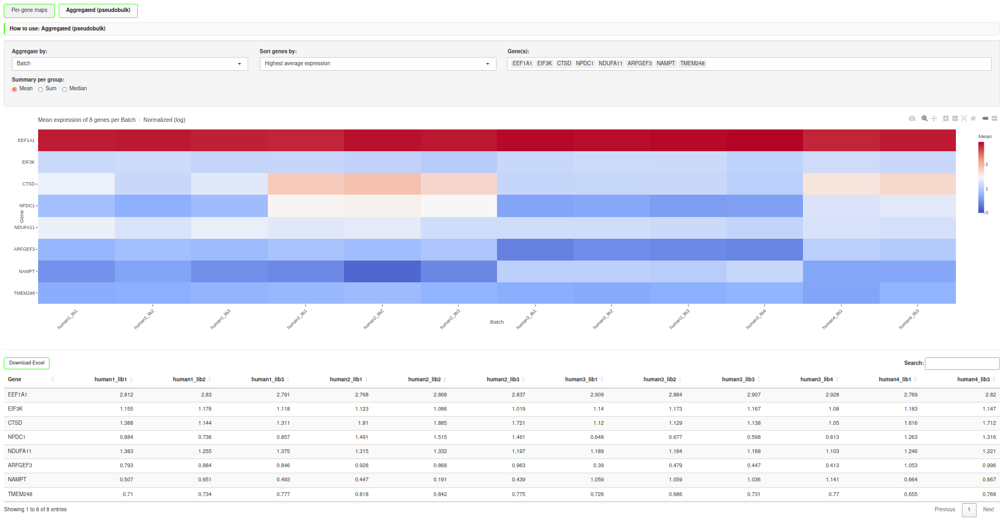
  <br><em>Figure 6. Aggregated: a gene by group heatmap plus the same numbers as a table.</em>
</p>

## 3. Cluster Markers

Genes that mark one group versus all other cells, computed live from the object.
Uses the RNA assay, Normalized (log) values and the Wilcoxon test.

| Control | What it does |
|---|---|
| Grouping column | The metadata column that defines the groups - a cell type column for markers per cell type, or a clustering for per cluster markers |
| Group | Which group to find markers for (that group vs everyone else) |
| Compute | Runs the computation. It does not run automatically |

Set the grouping column and group, then click Compute. After it runs, the search box filters the results and Download Excel
exports the whole table. Columns include avg_log2FC (how much higher in this group),
pct.1 / pct.2 (fraction of cells expressing it in the group vs the rest), and
p_val / p_val_adj (significance).

The table is sorted by fold change (avg_log2FC), so the strongest up-regulated markers
sit at the top and down-regulated genes at the bottom. This is the same computation and
ranking the Marker Plot dot plot uses, so the top of this table matches the genes the dot
plot shows for each group. Click any column header to re-sort, for example by p_val_adj
for significance order.

<p align="center">
  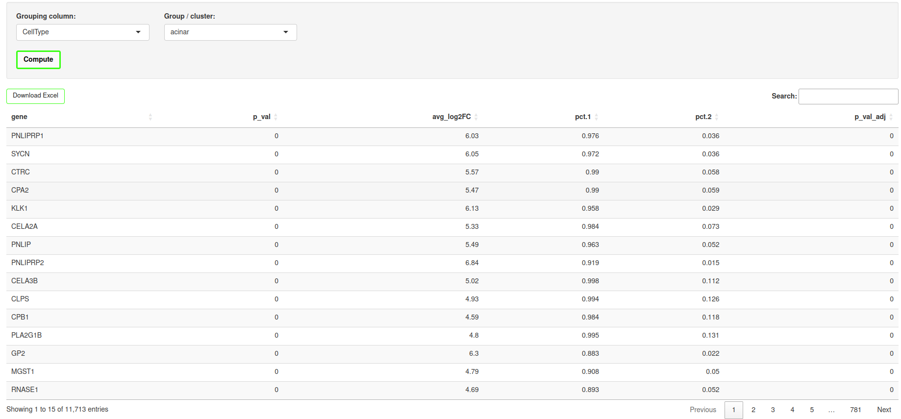
  <br><em>Figure 7. Cluster Markers: the top marker genes for one group versus the rest.</em>
</p>


## 4. Marker Plot

Chosen genes across a grouping column, as a dot plot or violins. Uses the RNA assay
and Normalized (log) values. Choose the Plot type first; the controls adapt to it.
Group by applies to both.

### Dot plot

Genes on the x axis, groups on the y axis. Dot size = percent of cells in the group
expressing the gene. Dot colour = mean expression z scored per gene across groups
(blue = low, red = high in that group), so you see which group each marker is
specific to.

- Genes: Top markers per group (auto) - finds each group's top markers
  automatically (Wilcoxon), ranked by fold change. Set Top markers / group, then click
  Compute. Only significant markers expressed in at least 25% of a group are kept. These
  are the same top markers as the top rows of the Cluster Markers table (same computation).
- Genes: Choose manually - type genes yourself.

<p align="center">
  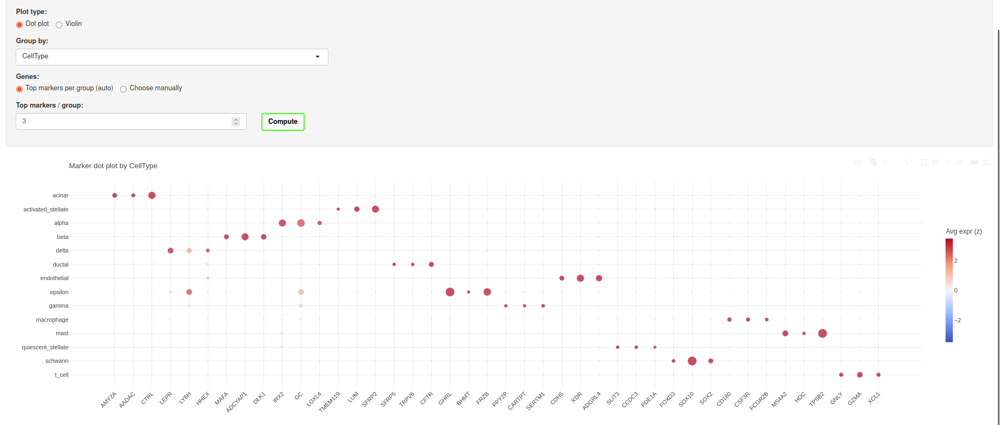
  <br><em>Figure 8. Marker dot plot: dot size is percent expressing, colour is z scored mean.</em>
</p>
<!-- SCREENSHOT 08-marker-dotplot.png : the Marker Plot tab, Plot type = Dot plot, with "Top markers per group (auto)" computed (or a manual gene set), showing the dot grid and colorbar. -->

### Violin

One row of violins per gene (x = group), showing the distribution: the violin
shape, an inner box (median and quartiles), and jittered cells. Pick genes in the
Genes to show box, then click Compute. Cells are downsampled for responsiveness.

<p align="center">
  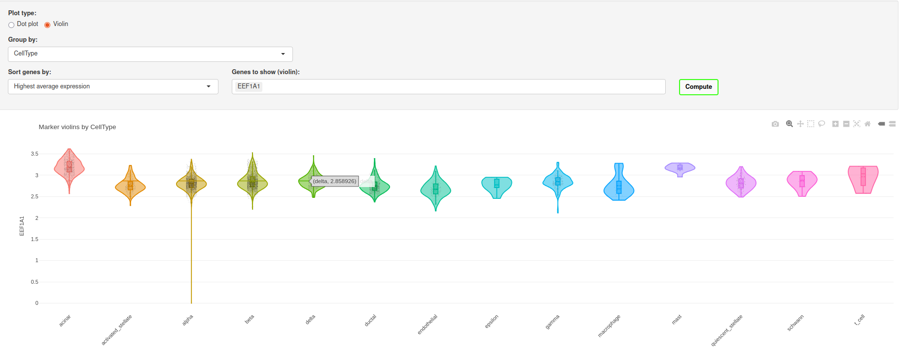
  <br><em>Figure 9. Marker violins: the per group distribution of each chosen gene.</em>
</p>
<!-- SCREENSHOT 09-marker-violin.png : the Marker Plot tab, Plot type = Violin, with a few genes chosen and computed, showing the stacked violin rows. -->

## 5. Differential expression

Genes that differ between two groups you choose (target A vs. reference B), for
example one condition vs. another. Unlike Cluster Markers (a group vs everyone
else), this is one group vs one specific other group.

| Control | What it does |
|---|---|
| Method | Pseudobulk DESeq2 (default), or Per cell test |
| Grouping column | The metadata column holding your two groups |
| Target (A) | The first group |
| Reference (B) | The group to compare against |


### Pseudobulk DESeq2

To compare conditions across samples. It sums raw RNA counts
per sample within each group, then runs DESeq2.

| Control | What it does |
|---|---|
| Sample / replicate column | The column identifying your replicates (for example the sample or batch column). Needs at least two samples per group. |
| Restrict to a subset (checkbox) | Tick to limit the test to one cell type or cluster. It reveals a column and level to restrict to. |
| Compute | Runs DESeq2 |

Table: gene, log2FoldChange, pvalue, padj, baseMean (downloadable to Excel). A
caption reports how many samples were found per group.

Note on the sample column: pick the real replicate column. If you pick a column
where one condition's cells are NA (for example a cell type column with cells
unannotated in one condition), those cells are dropped and a group can come out
empty.

<p align="center">
  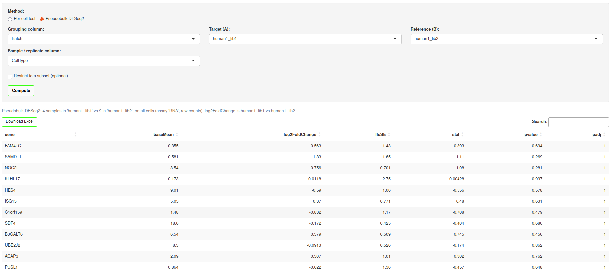
  <br><em>Figure 10. Differential expression: genes ranked by significance between two groups.</em>
</p>
<!-- SCREENSHOT 10-differential-expression.png : the Differential expression tab with a Method chosen, a grouping column and target/reference set, computed, showing the results table (log2FoldChange / padj columns). -->

### Per cell test

The fast, exploratory alternative. Uses the RNA assay, Normalized (log) values and
the Wilcoxon test, treating each cell as a replicate. Pick the two groups and click
Compute. For comparing conditions across samples it can inflate false positives, so
Pseudobulk is the default and recommended choice there. Use the per cell test for a
quick look, for cell type vs cell type comparisons, or when the data has no replicates.

## Quick reference - which tab for which question

| Question | Tab |
|---|---|
| What clusters / cell types are there? | Clusters / Metadata |
| How does one variable split across the map? | Clusters / Metadata (Split by group) |
| Where is gene X expressed? | Gene Expression (Per gene maps) |
| How does a gene panel compare across groups? | Gene Expression (Aggregated) |
| What defines this cluster / cell type? | Cluster Markers |
| Which markers are specific to each group (one figure)? | Marker Plot |
| How do groups A and B differ (gene table)? | Differential expression |


# Part 2 - Use cases

Four common workflows, each as numbered steps. They assume a dataset is already
loaded (see Loading data).

## Use case 1 - Find the marker genes that define your clusters

Goal: see which genes are characteristic of each cluster.

1. Open Clusters / Metadata and in "Color UMAP by" choose your clustering column to
   see the clusters laid out on the map.
2. Open Cluster Markers, set "Grouping column" to the same clustering, pick a cluster
   in "Group", and click Compute.
3. Read the top rows (sorted by fold change): genes with a high avg_log2FC and a high
   pct.1 are that cluster's markers.
4. Go to Gene Expression > Per gene maps, type a few of those genes, and confirm they
   light up specifically on that cluster's location.
5. Open Marker Plot, Plot type = Dot plot, set "Group by" to the clustering, choose
   "Top markers per group (auto)", set Top markers / group to 3 to 5, and click
   Compute to see every cluster's markers in one figure.

<p align="center">
  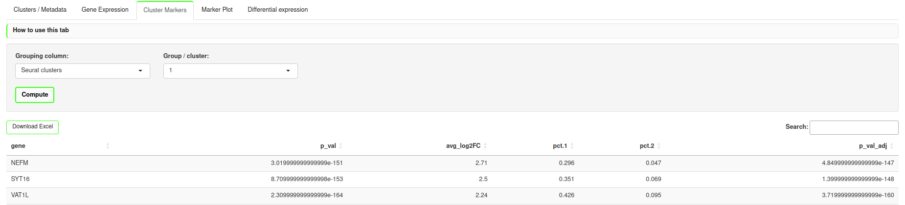
  <br><em>Figure 11. Use case 1: cluster markers. </em>
</p>
<p align="center">
  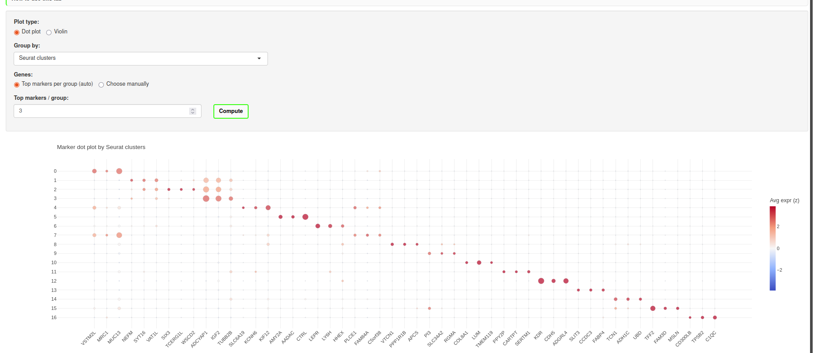
  <br><em>Figure 12. Use case 1: cluster markers summarised as a dot plot.</em>
</p>

> Sample answer: for cluster 1 in the example data the top markers are NEFM, SYT16 and VAT1L -
> the same genes at the top of the Cluster Markers table and as cluster 1's dots in the
> dot plot.

## Use case 2 - Check where your genes of interest are expressed

Goal: see the expression pattern of specific genes across the map and across
groups.

1. Open Gene Expression > Per gene maps.
2. Type your genes of interest in "Gene(s)". Each gets its own UMAP.
3. Set "Plots per row" for a comfortable layout, and keep "Same scale for all
   genes" to compare magnitude between genes (switch to "Scale adjusted per gene"
   if a weakly expressed gene is hard to see).
4. Read the maps: where a gene is red it is highly expressed. Hover any cell for
   the exact value.
5. For a compact numeric comparison, switch to the Aggregated (pseudobulk) sub tab,
   set "Aggregate by" to a grouping column (for example cell type or condition),
   type the same genes, and read the heatmap - one summary value per gene per group.
6. Save what you need: the camera icon on a plot, "Download all as one PNG" for the
   whole grid, or "Download Excel" for the aggregated table.

<p align="center">
  
  <br><em>Figure 13. Use case 2: expression maps for genes of interest. </em>
</p>
<p align="center">
  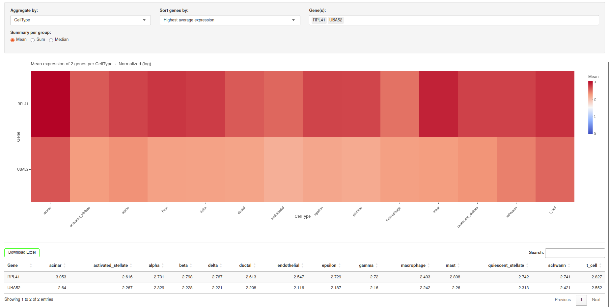
  <br><em>Figure 14. Use case 2: aggregated heatmap.</em>
</p>

> Sample answer: Both genes are expressed broadly and fairly uniformly across every cell type.  UMAPs are red almost everywhere and every column of the heatmap is coloured, with no cluster left blue. That is the signature of housekeeping genes (RPL41 is a ribosomal protein, UBA52 is a ubiquitin–ribosomal fusion), so this is expected: they are not specific to any population.

## Use case 3 - Compare two conditions and find differentially expressed genes

Goal: find genes that change between two conditions (for example treated vs
control) in a statistically sound way.

1. Open Differential expression. Method is set to "Pseudobulk DESeq2" by default,
   the recommended choice for comparing conditions across samples.
2. Set "Grouping column" to your condition column, then choose the Target (A) and
   Reference (B) conditions.
3. Set "Sample / replicate column" to your real replicate column (the one that
   identifies each sample, for example orig.ident or batch). It needs at least two
   samples per group; the caption confirms how many were found.
4. Optional: tick "Restrict to a subset" and choose a cell type or cluster to run
   the comparison within one population only.
5. Click Compute. Read the table sorted by padj: log2FoldChange is the direction
   and size of change (target vs reference), padj is the adjusted significance.
6. For a quick, exploratory look you can switch Method to "Per cell test" instead,
   but per cell tests treat each cell as a replicate and can inflate false positives
   for condition comparisons, so trust the pseudobulk result for conclusions.
7. Click Download Excel to export all genes for downstream work.

<p align="center">
  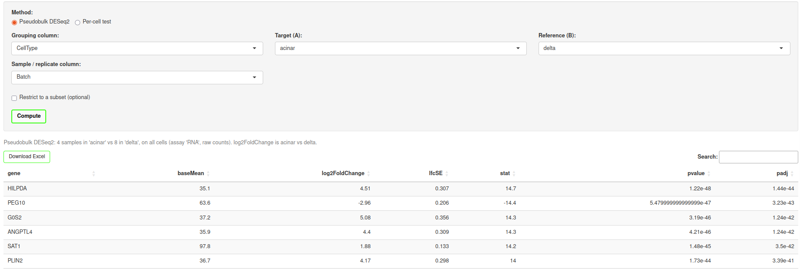
  <br><em>Figure 13. Use case 3: pseudobulk DESeq2 setup and the ranked results table.</em>
</p>

> Sample answer: Acinar vs. delta with Batch as the replicate column. Using Batch as the sample column, the two populations separate strongly and significantly. Genes up in acinar (positive log2FoldChange) are led by G0S2 (+5.08), HILPDA (+4.51), ANGPTL4 (+4.4) and PLIN2 (+4.17), a hypoxia and lipid/stress program; PEG10 (−2.96) is the top gene up in delta. All are highly significant (padj < 1e-41). Sort by padj for the most robust hits and by log2FoldChange for the largest changes (positive = higher in acinar, negative = higher in delta).


## Use case 4 - See how a condition or cell type is distributed across the map

Goal: compare where different groups of cells sit on the same embedding.

1. Open Clusters / Metadata.
2. In "Color UMAP by" choose the column you want the panels coloured by (for
   example cell type, so each panel keeps the same colour key).
3. Tick "Split by group".
4. In "Split by" choose the column that separates your groups (for example
   condition, or sample).
5. In "Groups to show" pick the two or more groups you want to compare.
6. Compare the panels side by side: each shows only that group's cells over a grey
   backdrop of all cells, on the same axes, with one shared legend. This makes it
   easy to spot a population that is present in one condition and missing in
   another.
7. Save the comparison with "Download all as one PNG".

<p align="center">
  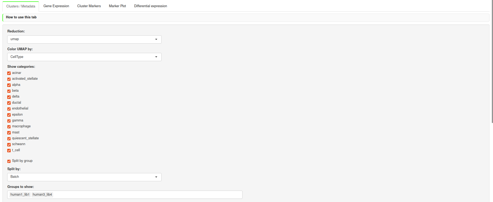
  <br><em>Figure 14. Use case 4: The Clusters / Metadata controls. </em>
</p>
<p align="center">
  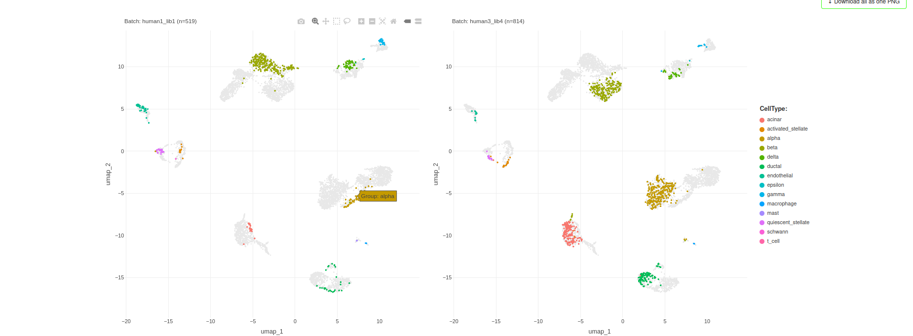
  <br><em>Figure 15. Use case 4: the same map split by condition to compare cell distributions.</em>
</p>

> Sample answer: (map coloured by CellType, split by Batch: human1_lib1 vs human3_lib4.) 
> Both donors contain the same cell types in the same map positions, so the two batches are well integrated (no batch effect). They differ only in composition: human3_lib4 (814 cells) has more alpha and acinar cells, while human1_lib1 (519 cells) is smaller and relatively richer in beta. So the samples share identity and structure but differ in the proportion of each cell type.